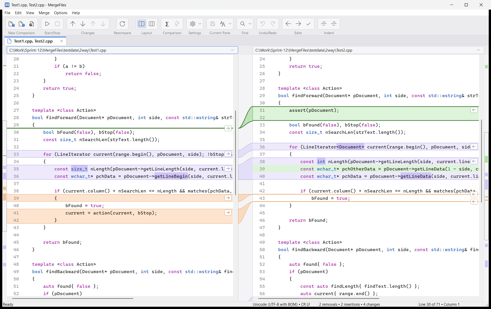
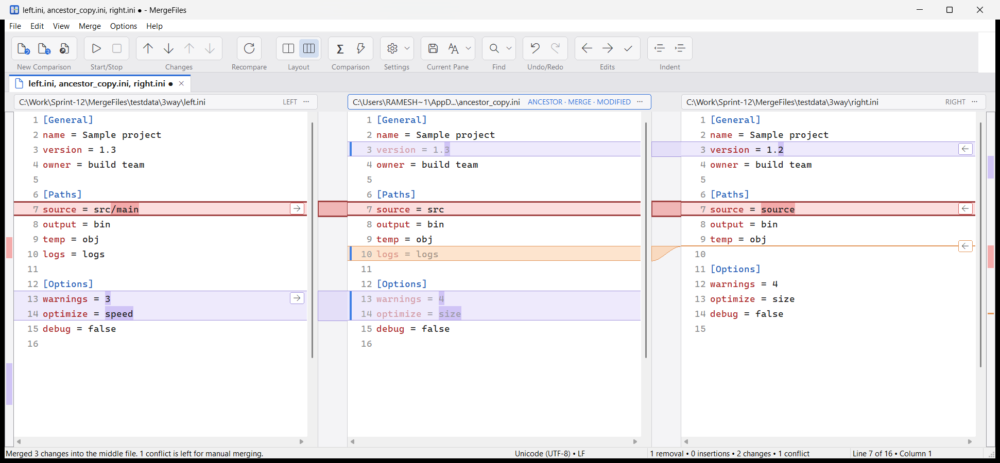
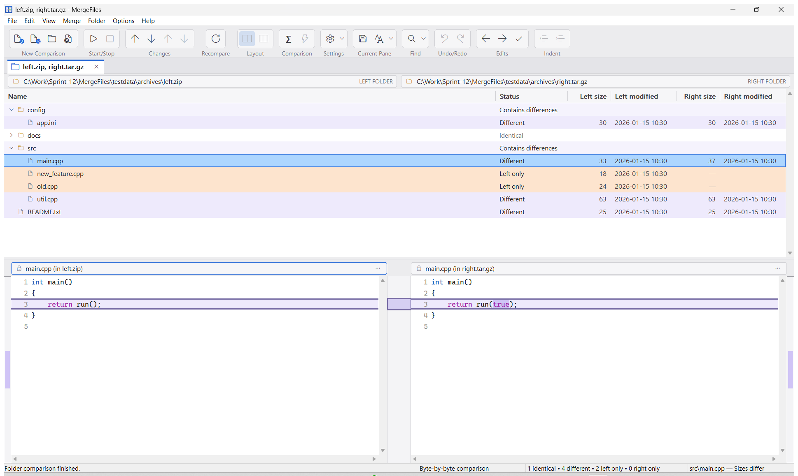
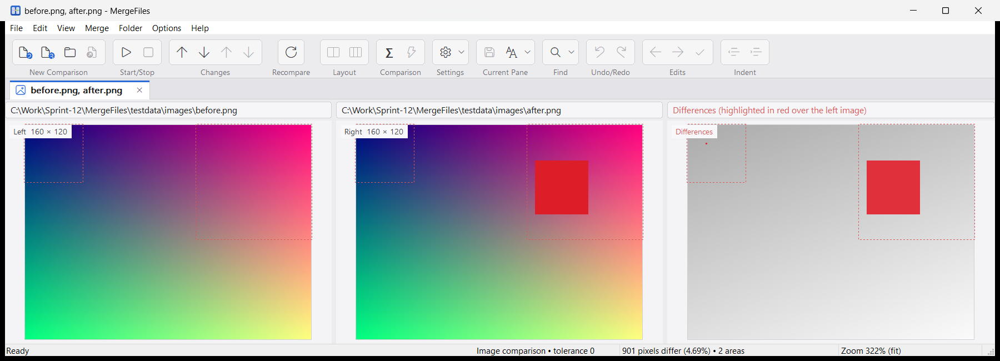
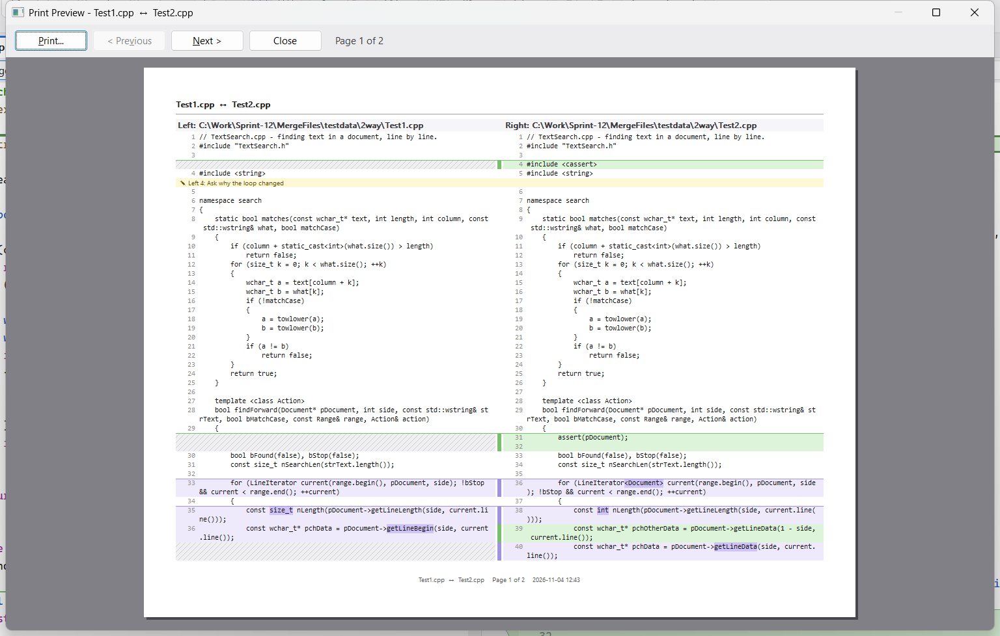

# MergeFiles

[](../../actions/workflows/build.yml)

**Two-way and three-way comparison and merging of files and folders for Windows.** MergeFiles shows
files side by side, tints the changed blocks, highlights the characters that changed inside them,
and joins each block to its counterpart with a curved link, so no blank padding lines are needed.
Merge by clicking the arrow on a block, by running an automatic three-way merge, or by editing in
place. It also compares folders and archives, binary files, images, and Word, Excel, PowerPoint,
OpenDocument and RTF documents. Reports, printing and single-file comparison archives cover review
and audit.

Native Windows x64 application (C++ and MFC), with a command-line tool built on the same engine.



## Contents

- [Getting MergeFiles](#getting-mergefiles)
- [Features](#features)
- [Using it](#using-it)
- [Command-line tool](#command-line-tool)
- [Building from source](#building-from-source)
- [Tests](#tests)
- [Continuous integration and releases](#continuous-integration-and-releases)
- [Project layout](#project-layout)
- [Known limitations](#known-limitations)

## Getting MergeFiles

Download `MergeFiles-<version>-win-x64.zip` from the [Releases](../../releases) page, unzip it
anywhere, and run `MergeFiles.exe`. The zip contains:

| File | What it is |
| --- | --- |
| `MergeFiles.exe` | the application |
| `MergeFilesCli.exe` | the [command-line tool](#command-line-tool) |
| `MergeFiles.html` | the help, opened with F1 |
| `README.md` | this file |

Requirements: Windows 10 or 11 (x64) and the
[Microsoft Visual C++ 2015-2022 Redistributable (x64)](https://aka.ms/vs/17/release/vc_redist.x64.exe),
which includes the MFC DLLs. A `.sha256` file next to each zip lets you check the download:

```powershell
(Get-FileHash MergeFiles-1.0.0-win-x64.zip -Algorithm SHA256).Hash
```

There is no installer yet; see [Known limitations](#known-limitations).

## Features

### Comparing and merging text

| Area | What you get |
| --- | --- |
| Comparison | Two-way and three-way line comparison (Myers O(ND) diff in linear space), changes inside lines highlighted by token, and lines inside a changed block paired by similarity |
| Three-way merge | Left, common ancestor (middle) and right. **Automatic merge** (Ctrl+M) applies every non-conflicting change to the middle file as one undoable step. Conflicts stay flagged in red until you resolve them. |
| Point-and-click merging | An arrow on each block copies it to the other side (into the middle file when comparing three). Alt+Right / Alt+Left do the same for the current change; *Replace File* copies a whole file. |
| Editing | Edit in place, with clipboard, auto-indent, block indent (Tab / Shift+Tab), drag and drop of text between panes, IME input, and one undo/redo history for the whole comparison. The comparison updates as you type. |
| Navigation | Next/previous change (Alt+Down/Up, F8), conflict (Ctrl+Alt+Down/Up), bookmark (F2), Go To Line (Ctrl+G), clickable overview strips, and synchronized scrolling that keeps corresponding lines level |
| Rules | Ignore whitespace, case, line endings and blank lines. **Line expressions** leave text out (for example `//.*$`); **block expressions** ignore everything between begin and end patterns; a **numeric tolerance** (absolute or relative) treats close numbers as equal; a **line-pairing rule** pairs lines by a key. Ignored differences are shown in grey and not counted. |
| Synchronization links | Force chosen lines to correspond (Ctrl+L) when the automatic alignment pairs the wrong lines |
| Bookmarks and comments | Bookmarks (Ctrl+F2) and **comments** (Ctrl+Shift+F2) shown as notes beside their lines. Comments move with their lines as you edit, and appear in reports, printouts and archives. |
| Display | Syntax highlighting (C/C++, C#, Java, JavaScript/TypeScript/JSON, Python, XML/HTML, INI, SQL, PowerShell, batch), line numbers, word wrap, optional padding lines, a line-detail panel, visible whitespace and line endings, and configurable font and colours |
| Encodings | Detects and keeps UTF-8 and UTF-16 LE/BE (with or without a BOM) and ANSI/MBCS. Files round-trip byte for byte. You can save in another encoding, reload as Shift-JIS or EUC-JP, and convert line endings. |



### Folders and archives

| Area | What you get |
| --- | --- |
| Folder comparison | Two or three folder trees in one view. Files show as identical, different, or on one side only; in three-way, as changed left, changed right, the same on both, or conflict. Runs in the background and can be stopped. |
| Compare modes | **Quick** (size and time), **byte by byte**, or **thorough** (text compared with the comparison rules; documents compared by their text) |
| Filters | Include and exclude wildcards (`.git\;.svn\;.hg\;.vs\` excluded by default), show/hide by status, and select files by pattern and status |
| Synchronize | Copy selected items left or right, and delete to the Recycle Bin. **Automatic folder merge** (three-way) applies one-sided changes to the ancestor folder and merges files changed on both sides line by line where there is no conflict. |
| File view | The selected file's comparison appears below the tree; images, binary files and nested archives open in their own tab |
| Archives | `.zip`, `.jar`, `.war`, `.ear`, `.nupkg`, `.vsix`, `.tar`, `.tgz` and `.tar.gz` can be used wherever a folder can: two archives, or an archive and a folder. They are read-only, and copying out of one extracts the files. The DEFLATE, gzip, zip (including ZIP64 and UTF-8 names) and tar (GNU and PAX) readers are built in. |



### Other kinds of files

| Area | What you get |
| --- | --- |
| Documents | Word (`.docx`), Excel (`.xlsx`), PowerPoint (`.pptx`), OpenDocument (`.odt`, `.ods`, `.odp`) and RTF files compare by their text, read-only. Each paragraph or table row is one line (cells separated by tabs), with `[Sheet: name]` and `[Slide n]` headings. |
| Binary files | Hex panes side by side with differing bytes highlighted. Files up to 1 MB are aligned, so inserted bytes don't make the rest of the file differ. |
| Images | Left, right and a difference panel showing changed pixels in red. Differing areas are outlined, with zoom, pan and a colour tolerance. |
| Patches | Open a unified diff (git, svn, `diff -u`), review its hunks, and apply the ones you tick (with offsets) or reverse them. Each patched file opens as a comparison to review before saving. |
| XML | Compare as formatted XML (one element per line) |



### Reports, archives and printing

| Area | What you get |
| --- | --- |
| Reports | File > Create Report (Ctrl+E): **HTML** side by side in the comparison's colours, an **HTML slideshow** (one difference per slide), **XML**, or a **unified diff**. Whole files or differences with N lines of context. A folder report can include a report of each different file. |
| Comparison archives | Save a whole comparison as one `.mfcmp` file to send for review: the text of every file, encodings, rules, bookmarks, comments, resolved lines and links. A folder comparison archive keeps the results, and Start compares the folders again. |
| Printing | Print and print preview of file and folder comparisons in colour, side by side, with headers and footers (`{title}`, `{files}`, `{date}`, `{page}`, `{pages}`), orientation, font size, and *print only pages with changes* |
| Help | F1 opens the help at the topic for the current tab or dialog |



## Using it

```powershell
MergeFiles.exe                                   # then File > New (Ctrl+N), or drop files on the window
MergeFiles.exe left.cpp right.cpp                # two-way
MergeFiles.exe left.cpp ancestor.cpp right.cpp   # three-way, merging into the middle file
MergeFiles.exe C:\src\v1 C:\src\v2               # folders
MergeFiles.exe release1.zip release2.tar.gz      # archives, compared as folders
MergeFiles.exe v1.docx v2.docx                   # documents, compared by their text
MergeFiles.exe before.png after.png              # images
MergeFiles.exe fix.patch                         # review and apply a patch
MergeFiles.exe review.mfcmp                      # a saved comparison archive
```

In a three-way comparison the **middle file is the merge target**: automatic merge and the arrow
buttons change it, and Ctrl+S saves the file in the current pane.

Common keys:

| Keys | Command |
| --- | --- |
| Alt+Down / Alt+Up | next / previous change |
| Alt+Right / Alt+Left | copy the current change right / left |
| Ctrl+M | automatic merge |
| Ctrl+R / Ctrl+Shift+R | mark / unmark lines as resolved |
| Ctrl+S, Ctrl+Shift+S | save the current pane, save all |
| Ctrl+F, Ctrl+H, F3 | find, replace, find next |
| Ctrl+F2, F2, Ctrl+Shift+F2 | toggle bookmark, next bookmark, bookmark comment |
| Ctrl+E, Ctrl+P | create report, print |
| F5 | compare again (folders: start) |
| F1 | help |

The full list is in the help (F1, or [docs/help.html](docs/help.html)).

## Command-line tool

`MergeFilesCli.exe` runs the same engine from scripts and build pipelines. Exit codes: 0 means
the inputs are the same (or the merge was clean), 1 means they differ (or there are conflicts), and
2 means an error.

```text
MergeFilesCli diff  <file1> <file2> [options]              unified diff
MergeFilesCli diff3 <left> <ancestor> <right> [options]    three-way chunk list
MergeFilesCli merge <left> <ancestor> <right> [-o <out>] [--markers] [options]
MergeFilesCli dircmp  <left> <right> [folder options]      folder (or archive) comparison
MergeFilesCli dircmp3 <left> <ancestor> <right> [...]      three-way folder comparison
MergeFilesCli dirmerge <left> <ancestor> <right> [--dry-run] [--no-recycle-bin] [...]
MergeFilesCli bincmp <file1> <file2>                       differing byte ranges
MergeFilesCli imgcmp <image1> <image2> [--tolerance N] [--diff-image <out.png>]
MergeFilesCli patch <patch-file> <folder> [-p N] [--dry-run] [--reverse]
MergeFilesCli xmlfmt <file> [-o <out>]                     one XML element per line
MergeFilesCli report <left> <right> [<third>] [--format html|slideshow|xml|diff] [--context N] [-o <out>]
MergeFilesCli dirreport <left> <right> [<third>] [--xml] [--files] [--all] [-o <out>]
MergeFilesCli doctext <document> [-o <out>]                text of a Word/Excel/PowerPoint/OpenDocument/RTF file
MergeFilesCli info <file>...                               encoding, line endings, line count
MergeFilesCli roundtrip <file>...                          does decoding and re-encoding reproduce every byte?

Options: --ignore-whitespace  --ignore-all-whitespace  --ignore-case  --strict-eol
         --ignore-blank-lines  --line-expr <regex>  --block <begin> <end>  --tolerance <n>  --rel-tolerance <%>
Folder options: --mode quick|binary|thorough  --include <patterns>  --exclude <patterns>  --all
```

`diff`, `diff3` and `merge` read documents as text; `dircmp`, `dircmp3` and `dirreport` accept
archives in place of folders.

## Building from source

Requirements: Windows 10 or 11 and Visual Studio 2022 with the *Desktop development with C++*
workload and the *C++ MFC for latest v143 build tools (x86 & x64)* component. CMake comes with
Visual Studio, so you don't need to install it separately.

```powershell
powershell -File scripts\build.ps1                     # Release build into build\bin\Release
powershell -File scripts\build.ps1 -Test               # ... then run every test
powershell -File scripts\build.ps1 -Config Debug
powershell -File scripts\build.ps1 -Version 1.4.0 -BuildNumber 12 -WarningsAsErrors   # as the CI does
powershell -File scripts\package.ps1 -Version 1.4.0    # dist\MergeFiles-1.4.0-win-x64.zip + .sha256
```

Or by hand:

```powershell
cmake -S . -B build -G "Visual Studio 17 2022" -A x64
cmake --build build --config Release
```

Opening `build\MergeFiles.sln` in Visual Studio also works. About the code:

- It builds at `/W4 /utf-8 /permissive-` with no warnings, and CI builds with `/WX`.
- MFC is linked as a shared DLL.
- No third-party libraries are used.
- Formatting follows [.clang-format](.clang-format) (Allman style).

## Tests

```powershell
powershell -File scripts\test.ps1
```

- **`MergeFilesTests.exe`** runs 70 engine unit tests, covering:
  - the diff (checked against a brute-force LCS on random inputs), and three-way chunks and merges;
  - byte-exact encoding round trips, and buffer editing with undo/redo;
  - the comparison rules, and folder comparison and merging on temporary folder trees;
  - byte and pixel comparison, and patches;
  - reports, the XML reader, and comparison archives;
  - DEFLATE, zip and tar reading, and archives compared as folders;
  - the exact text taken from sample Word, Excel, PowerPoint, OpenDocument and RTF files.
- **`MergeFilesCli.exe`** is checked against the sample files in [testdata/](testdata):
  - encoding round trips and line-ending handling;
  - the expected three-way merges, and the expected folder statuses and folder merge;
  - binary, image, patch and XML commands, and reports;
  - archives compared as folders, and documents compared as text.

The document and archive samples are generated by
[testdata/make_samples.py](testdata/make_samples.py), so they can be rebuilt.

## Continuous integration and releases

[.github/workflows/build.yml](.github/workflows/build.yml) runs on every pull request and every push
to `main`. It runs on a `windows-2022` runner (Visual Studio 2022 with MFC) and:

1. works out the next version with [scripts/next_version.ps1](scripts/next_version.ps1);
2. builds with warnings as errors, stamping the version and the run number into the programs
   (for example `1.4.0.57`);
3. runs the unit tests and CLI checks;
4. checks the version stamp of `MergeFiles.exe`;
5. packages the zip and its SHA-256 file, and uploads them as a build artifact.

On a push to `main`, a second job tags the commit `v<version>` and publishes a GitHub release with
the zip. The version comes from the commit messages since the last tag, in the
[Conventional Commits](https://www.conventionalcommits.org) style:

| Commits since the last tag | Next version |
| --- | --- |
| `feat!: ...` (any `type!:`) or `BREAKING CHANGE:` | major: 1.3.2 → 2.0.0 |
| `feat: ...` or `feat(scope): ...` | minor: 1.3.2 → 1.4.0 |
| anything else (`fix:`, `docs:`, `chore:`, ...) | patch: 1.3.2 → 1.3.3 |

The first release uses `MERGEFILES_VERSION` from `CMakeLists.txt` (1.0.0). Put `[skip release]` in a
commit message to build and test without releasing.

## Project layout

```text
CMakeLists.txt          engine library, CLI, tests and GUI
.github/workflows/      CI: build, test, package, release
scripts/
  build.ps1             configure and build with Visual Studio 2022's CMake
  test.ps1              unit tests and CLI checks on testdata\
  package.ps1           the release zip and its SHA-256
  next_version.ps1      next release version from tags and commit messages
src/engine/             mergefiles_engine.lib (no MFC)
  Diff.*, Diff3.*       Myers diff, three-way chunks and automatic merge
  InlineDiff.*          changes inside lines, line pairing within a block
  Compare.cpp           the comparison pipeline: rules, synchronization points, tolerance
  Encoding.*            encoding detection, decoding/encoding, safe file writes
  TextLines.*, TextBuffer.*, Comparison.*   lines, editable text, the document of one tab with undo/redo
  Syntax.*, Search.*    syntax highlighting, find
  FolderCompare.*       folder scanning, compare modes, three-way classification, copy/delete, folder merge
  Packed.*              DEFLATE/gzip decoder, zip and tar readers
  DocumentText.*        text of Word, Excel, PowerPoint, OpenDocument and RTF files
  BinaryDiff.*, ImageDiff.*, Patch.*, XmlFormat.*   bytes, images (WIC), unified diffs, XML layout
  Xml.*, Report.*, Archive.*   XML reader, reports, comparison archives (.mfcmp)
src/cli/main_cli.cpp    MergeFilesCli.exe
src/app/                MergeFiles.exe (MFC)
  MainFrame.*           frame, tabs, toolbar, status bar, drag and drop, routing of what opens where
  CompareWnd.*, PaneView.*, LinkGutter.*, OverviewStrip.*, LineDetailPanel.*   the text comparison
  FolderCompareWnd.*, FolderTreeView.*   the folder comparison
  BinaryCompareWnd.*, ImageCompareWnd.*, PatchWnd.*   bytes, images and patches
  Printing.*, Output.*  printing and preview; report, page setup and comment dialogs
  Dialogs.*, OptionsDlg.*   other dialogs and the Options pages
tests/                  unit tests (small built-in runner)
testdata/               sample files for the tests (see make_samples.py)
docs/help.html          the help, copied next to the program as MergeFiles.html
docs/Plan.md            how the requirements were built, phase by phase
```

## Known limitations

- **Not yet built:** PDF text extraction, and an installer (unzip the release instead). See
  [docs/Plan.md](docs/Plan.md).
- **Documents** are compared as text and read-only. Formatting, images and formulas are not
  compared. Old binary Office files (`.doc`, `.xls`, `.ppt`) are not read.
- **Archives** are read-only:
  - Each entry is read whole into memory (up to 2 GB), and `.tar.gz` files are decompressed into
    memory when opened.
  - Encrypted entries, and compression methods other than stored and deflate, cannot be read.
- **Folder synchronization:** overwritten files cannot be restored (deleted ones go to the Recycle
  Bin). After an automatic folder merge, a file merged line by line still shows *Conflict*; its
  note says it was merged.
- **Folder comparison archives** keep the results, not the files: opening a file from one shows the
  file as it is now.
- **Printing** was checked in the print preview, not on paper.
- **Binary and image comparisons** are two-way and read-only. Patches that delete files list the
  deletion but leave it to you.
- **Encodings:** files without a BOM in Shift-JIS or another multi-byte code page open with the system
  code page; use *Current Pane > Reload As*. IME input has not been tried with a real
  Asian-language IME.
- **Very large files:** syntax highlighting is re-computed from the top of the file after each edit,
  which slows down on files with hundreds of thousands of lines.
